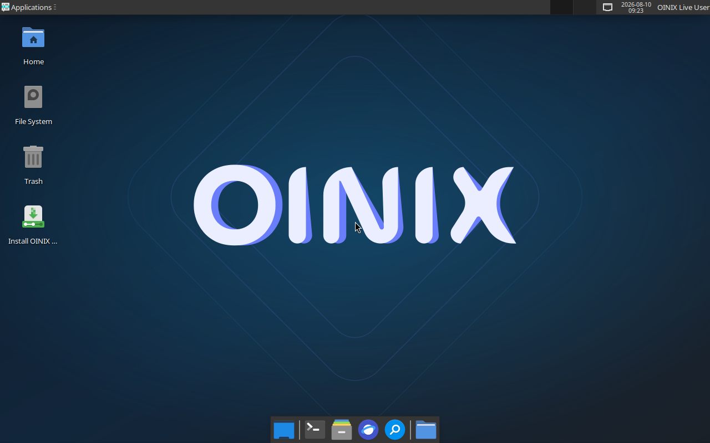
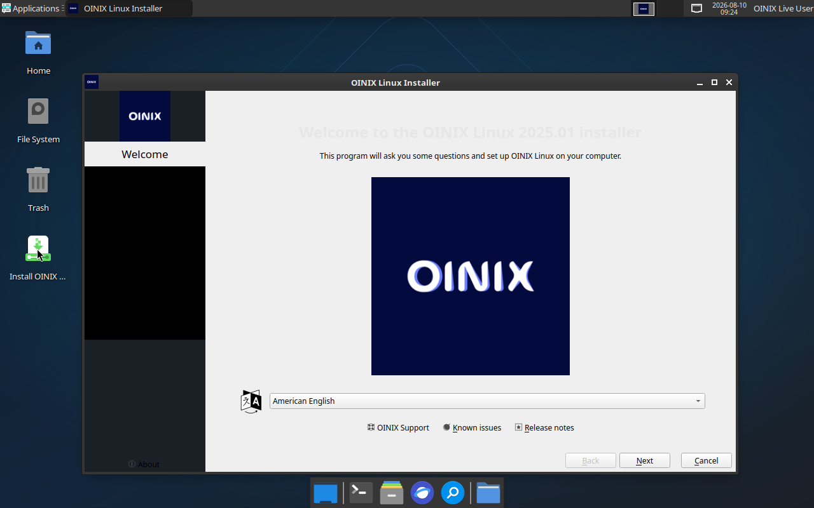
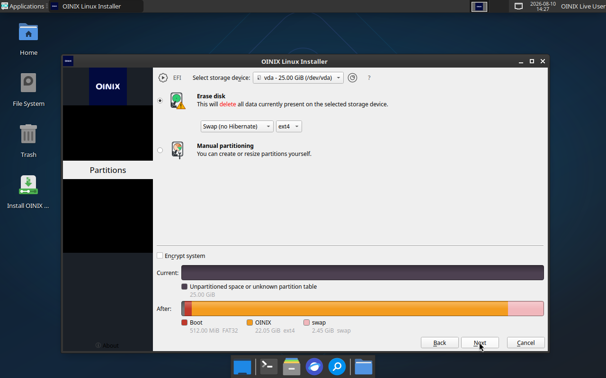

<p align="center"></p>
<p align="center"><b>A minimal Arch-based Linux distribution by the <a href="https://xinux.uz">Xinux community</a>, Uzbekistan</b></p>
<p align="center">
  
  
  
  
</p>

---

An [archiso](https://gitlab.archlinux.org/archlinux/archiso) profile that builds
a hybrid BIOS/UEFI live ISO: Xfce desktop, autologin, and a branded Calamares
installer.

<p align="center"></p>

| | |
|---|---|
| Base | Arch Linux, rolling |
| Desktop | Xfce 4 · LightDM · PipeWire · NetworkManager |
| Installer | Calamares 3.4, `oinix` branding |
| Boot | `bios.syslinux` + `uefi.systemd-boot` |
| Live user | `oinix` / `oinix` (autologin); `root` has no password |

## Build

`mkarchiso` needs an x86_64 Linux host with mount privileges, so `build.sh`
runs it inside a privileged `linux/amd64` container. On the host you only need
**Docker** — including Docker Desktop on Apple Silicon.

```sh
./build.sh                  # release ISO (xz squashfs)
./build.sh --fast           # zstd squashfs: much quicker, larger image
./build.sh --no-installer   # skip Calamares while iterating
./build.sh --installer      # rebuild the Calamares package only
./build.sh --clean          # drop work/, out/ and localrepo/
```

The image and its `.sha256`/`.b2` checksums land in `out/`. The package cache
lives in a Docker volume, so repeat builds skip the ~1.5 GB download.

`make` on its own lists the equivalent targets.

## Test

```sh
./test-qemu.sh              # UEFI boot in a QEMU window
./test-qemu.sh --bios       # legacy BIOS

tests/boot-check.py --firmware uefi --disk 25G \
    --double-click 59,392@330 --at 300,375
```

`boot-check.py` boots headless and writes framebuffer grabs to
`out/boot-check/`. `--click`/`--double-click X,Y@T` drive the guest pointer, so
the installer can be launched and stepped through unattended — that is how the
screenshots below were produced.

<p align="center">
  
  
</p>

## Layout

| Path | Purpose |
|---|---|
| `profiledef.sh` | ISO name, label, boot modes, squashfs compression |
| `packages.x86_64` | every package in the live system |
| `pacman.conf` | build-time repositories, incl. the local Calamares repo |
| `airootfs/` | files overlaid onto the live root |
| `airootfs/root/customize_airootfs.sh` | in-chroot setup: locales, live user, services |
| `airootfs/etc/calamares/` | installer module configuration |
| `airootfs/usr/share/calamares/branding/oinix/` | installer branding |
| `syslinux/` · `efiboot/loader/` · `grub/` | BIOS · UEFI · loopback boot menus |
| `build/` | container image and in-container build scripts |
| `tests/boot-check.py` | unattended headless boot test |

## Notes

**Calamares is built, not vendored.** Arch does not ship Calamares, so
`build/build-calamares.sh` builds it from the AUR into `localrepo/`, which
`pacman.conf` exposes as `[oinix-local]`. OINIX supplies only the branding
component and the module configuration.

**The installer is removed on install.** `modules/packages.conf` drops
Calamares and the other live-only packages from the target system, and
`shellprocess-final.conf` clears the live medium's autologin, password-less
polkit rule and archiso scaffolding before the first boot.

## License

GPL-3.0 — see [LICENSE](LICENSE).

<p align="center">OINIX &copy; <a href="https://xinux.uz">Xinux Jamiyati</a></p>
